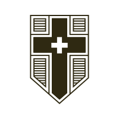
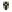
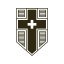
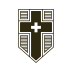
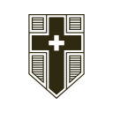
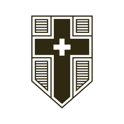

The sample image "Schilten.svg" used here was created by the user Jensche on Wikimedia Commons.

Schilten.svg, Schilten.ico and all other image files within this directory are licensed under the [Creative Commons](https://en.wikipedia.org/wiki/en:Creative_Commons "w:en:Creative Commons") [Attribution-Share Alike 4.0 International](https://creativecommons.org/licenses/by-sa/4.0/deed.en "creativecommons:by-sa/4.0/deed.en") license.

Page: https://commons.wikimedia.org/wiki/File:Schilten_Neu.svg
File: https://upload.wikimedia.org/wikipedia/commons/4/4c/Schilten_Neu.svg?utm_source=commons.wikimedia.org&utm_campaign=index&utm_content=original

Jensche, CC BY-SA 4.0 <https://creativecommons.org/licenses/by-sa/4.0>, via Wikimedia Commons

# Images

## Original

### Schilten.svg

## Derivatives

### Schilten-0.png (12x12)

### Schilten-1.png (16x16)

### Schilten-2.png (20x20)

### Schilten-3.png (24x24)

### Schilten-4.png (32x32)

### Schilten-5.png (48x48)

### Schilten-6.png (64x64)

### Schilten-7.png (72x72)

### Schilten-8.png (128x128)

### Schilten-9.png (256x256)

### Schilten-10.png (512x512)

### Schilten.ico

